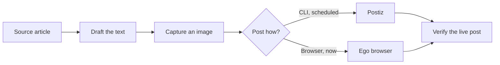

<div align="center">


<br>

**A working folder of AI skills and notes for writing social posts and email campaigns, then publishing and checking them.**

<br>

[](LICENSE)
[](#skills)
[](#route-a-postiz-cli)
[](#route-b-ego-browser)
[](#route-b-ego-browser)

[](https://github.com/harshith-vaddiparthy/content-toolkit/stargazers)
[](https://github.com/harshith-vaddiparthy/content-toolkit/commits)

**[What's inside](#whats-inside) · [Skills](#skills) · [Workflow](#how-it-works) · [Quick start](#quick-start) · [Spacing](#spacing-cheat-sheet) · [Lessons](#lessons-learned) · [Status](#status) · [Help](#need-help)**

</div>

---

## What's inside

```
content-toolkit/
├── Social Posts/
│   ├── .agents/skills/
│   │   ├── humanizer-zh-en/            English translation of the Humanizer-zh editing skill
│   │   ├── postiz-post-with-image/     Post or schedule through the Postiz CLI, with an image
│   │   └── ego-browser-linkedin-post/  Post to LinkedIn by driving the composer in Ego browser
│   ├── .claude/skills/                 Links so Claude Code finds the skills
│   └── images/                         Post images (git-ignored)
├── Email Campaigns/                    Reserved for templates and workflows (not started)
├── assets/banner.svg
└── LICENSE
```

> `.agents` and `.claude` are hidden folders. On macOS, press <kbd>Cmd</kbd> + <kbd>Shift</kbd> + <kbd>.</kbd> in Finder to see them.

## Skills

| Skill | What it does | Uses |
|---|---|---|
| [`ego-browser-linkedin-post`](Social%20Posts/.agents/skills/ego-browser-linkedin-post/SKILL.md) | Finds the source article, drafts the post, captures an image at full size, types it into LinkedIn's composer, posts, and checks the live post | [Ego browser](#route-b-ego-browser), Firecrawl |
| [`postiz-post-with-image`](Social%20Posts/.agents/skills/postiz-post-with-image/SKILL.md) | Same job through the Postiz CLI: spacing that renders properly, an image on every post, scheduling, and a publish check | [Postiz CLI](#route-a-postiz-cli) |
| [`humanizer-zh-en`](Social%20Posts/.agents/skills/humanizer-zh-en/SKILL.md) | English translation of the Humanizer-zh editing skill: cuts filler and templated phrasing while keeping facts, certainty, and the author's voice | none |

> **Heads up:** `humanizer-zh-en` is a translation. Its rules and 31 patterns are unchanged, and it still targets Chinese text. For English posts, use its principles rather than its Chinese-specific patterns.

## How it works



Every post follows the same five rules, whichever route you take:

1. **Facts come from the source.** Prefer the company's own announcement over press coverage.
2. **No invented opinions or experiences.** Plans stay plans ("expects to", "not available yet").
3. **Every post gets an image** from the source article, and the image's origin is stated.
4. **Blank lines between paragraphs.** The way to make them differs by route; see [Spacing](#spacing-cheat-sheet).
5. **Nothing is "posted" until it is checked** on the live page.

## Quick start

<details open>
<summary><b>1. Get the repo</b></summary>

```bash
git clone https://github.com/harshith-vaddiparthy/content-toolkit.git
cd content-toolkit/"Social Posts"
```

Skills here are project-level. Open Claude Code inside `Social Posts` so it finds `.claude/skills`.

</details>

<details>
<summary><b>2. Install the third-party skills</b></summary>

They keep their own licenses and are not copied into this repo. Run these inside `Social Posts`:

```bash
npx skills add gitroomhq/postiz-agent
npx skills add https://github.com/op7418/humanizer-zh --skill humanizer-zh
```

The first is the Postiz skill (AGPL-3.0). The second is the original Chinese Humanizer-zh (MIT). Review any skill before use; skills run with full agent permissions.

</details>

<details id="route-a-postiz-cli">
<summary><b>3a. Route A: set up Postiz</b></summary>

```bash
npm install -g postiz
postiz auth:login
postiz integrations:list
```

`integrations:list` shows your connected channels and their ids. Postiz needs an account at [postiz.com](https://postiz.com) with the channels connected.

</details>

<details id="route-b-ego-browser">
<summary><b>3b. Route B: set up Ego browser</b></summary>

Install Ego browser, sign in to LinkedIn in it, then run:

```bash
ego-browser skill
```

That prints the usage guide for your installed version, and the `ego-browser-linkedin-post` skill builds on it. Firecrawl is used for reading source articles.

</details>

<details>
<summary><b>4. Try it</b></summary>

Say any of these to Claude Code from `Social Posts`:

```text
Using the humanizer skill, write a LinkedIn post about <article URL>.
```

```text
Check that article, write a LinkedIn post with an image from it, and post it to my LinkedIn using Ego browser.
```

```text
Draft that as a LinkedIn post and schedule it with Postiz for tomorrow at 9am.
```

</details>

## Spacing cheat sheet

LinkedIn collapses blank lines unless you create them the right way.

| Route | How to get a blank line between paragraphs |
|---|---|
| **Postiz CLI** | Put an empty `<p></p>` between `<p>` paragraphs, and pass `--shortLink false` so your source link keeps its real address |
| **Ego browser** | Type each line with `keyboard.insertText`, then press <kbd>Enter</kbd>; a blank line is a second <kbd>Enter</kbd>. Pasting multi-line text drops the blank lines |

```html
<p>Opening line that states the news.</p><p></p><p>Second paragraph.</p><p></p><p>1. First step.</p><p>2. Second step.</p>
```

## Lessons learned

<details>
<summary><b>Posting through Ego browser (click to expand)</b></summary>

- **Attach the image before typing anything.** After a URL appeared in the text, LinkedIn's Media button disappeared. Attach first, then type.
- **Arm the file chooser before clicking Media.** Otherwise Ego cancels the system dialog and the Editor modal sticks on "Loading". Click Back and retry.
- **Pasting loses blank lines.** Type line by line (see above).
- **Capture article images with CDP, not a screenshot.** `page.screenshot()` is capped at the viewport (about 900 px wide). `Page.captureScreenshot` with a `clip` and `scale: 2` gives a sharp image; then shrink it with `sips -Z 2000`.
- **LinkedIn shortens your link** to `lnkd.in` on its own. That cannot be turned off from the composer.
- **The newest post has no direct link yet.** Use your activity page to confirm it.

</details>

<details>
<summary><b>Posting through Postiz (click to expand)</b></summary>

- **Plain paragraphs run together on LinkedIn.** Plain `<p>` blocks are joined with a single newline. Add an empty `<p></p>` between paragraphs.
- **Postiz shortens links by default.** The source URL turned into a `dub.sh` link. Use `--shortLink false`.
- **Check for `PUBLISHED`, not `QUEUE`.** A scheduled post can sit in the queue for a short while after its time.
- **Postiz can't edit a published LinkedIn post.** Fixing one means deleting it and republishing, which removes its reactions and comments.

</details>

<details>
<summary><b>Capturing a frame from an article's video (click to expand)</b></summary>

The Vimeo hero video in one article could only be captured with these workarounds:

- The browser pane caps screenshots at 800 × 600, and the `zoom` action adds no resolution.
- A page in the pane could not reach `localhost`, so exporting a canvas to a local server failed.
- Setting `video.currentTime` clamped to an earlier time. Playing the video and sampling screenshots worked.
- Zooming the video element with CSS so the target fills the viewport gives the sharpest result the pane can produce.

The full steps are in the [Postiz skill](Social%20Posts/.agents/skills/postiz-post-with-image/SKILL.md#capturing-a-frame-from-an-embedded-video).

</details>

## Status

Honest notes on what has and has not been checked:

| Piece | State |
|---|---|
| Ego browser route | Used for one LinkedIn post on a personal profile, with an image. The live post was checked afterwards |
| Postiz route | Used for one LinkedIn post. That post exposed the spacing and short-link problems the skill now fixes. The corrected format comes from earlier published posts and has not been re-run |
| `humanizer-zh-en` | Structure compared against the original (31 patterns, 14 sections, 18 test cases). Not run end to end on real text |
| Not tried | Company pages, video or document posts, scheduling through Ego, channels other than LinkedIn, the Email Campaigns folder |

## Need help?

Hit a problem, or something here does not work for you? **Email [hi@harshith.com](mailto:hi@harshith.com)** with what you ran and what you saw, and I will take a look.

## Credits

| Project | Role | License |
|---|---|---|
| [Humanizer-zh](https://github.com/op7418/Humanizer-zh) by 歸藏 | The skill `humanizer-zh-en` translates | MIT |
| [blader/humanizer](https://github.com/blader/humanizer) | Upstream of Humanizer-zh | see repo |
| [hardikpandya/stop-slop](https://github.com/hardikpandya/stop-slop) | Reference for concise editing | see repo |
| [Postiz](https://postiz.com) and [`postiz-agent`](https://github.com/gitroomhq/postiz-agent) | Scheduling CLI and skill, installed separately | AGPL-3.0 |
| Ego browser | Browser the LinkedIn route drives | see its own terms |

Images captured from articles belong to their publishers and are not included in this repository.

## License

[MIT](LICENSE) © 2026 Harshith Vaddiparthy. Third-party material keeps its own license, as noted in [Credits](#credits) and in the `LICENSE` file.
